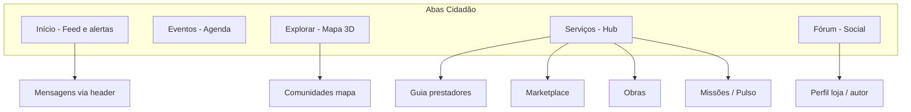

# ROTA App — Documento de Design

Guia de referência visual e funcional do aplicativo móvel **ROTA** (React Native / Expo). Descreve objetivos de cada aba, tokens de design, padrões de interface e estilos concretos extraídos do código-fonte.

---

## 1. Visão geral do produto

O ROTA é um **super app municipal whitelabel**: cada build aponta para um `hostId` (ex.: Maricá, Piraí) via `EXPO_PUBLIC_HOST_ID`. O cidadão acessa notícias, mapa, serviços públicos, fórum do bairro e eventos; lojas parceiras usam um **modo comerciante** separado (`/comerciante`).

**Princípios visuais:**
- Interface **clara e municipal**: fundos claros (`#fff`, `#F8FAFC`, `#ECEFF3`), acentos em **cyan/teal** (`#0891b2`, `#14b8a6`).
- **Headers com gradiente** azul → teal nos pontos de entrada (Início, comerciante).
- **Cards brancos** com borda sutil, sombra leve e cantos arredondados (12–20px).
- **Ícones**: Ionicons (navegação geral) e Feather (acesso rápido em Serviços).
- Feedback háptico no iOS ao tocar abas (`HapticTab`).

---

## 2. Design tokens (`constants/theme.ts`)

### 2.1 Cores primárias e acentos

| Token | Valor | Uso |
|-------|-------|-----|
| `AppColors.primary` | `#0066CC` | FAB do fórum, botões primários legados |
| `AppColors.primaryLight` | `#0891b2` | Tab ativa, links, chips ativos |
| `AppColors.accent` | `#06b6d4` | Botões de confirmação em modais |
| `AppColors.tab.active` | `#0891b2` | Ícone/label da aba selecionada |
| `AppColors.tab.inactive` | `#6b7280` | Abas inativas |

### 2.2 Texto

| Token | Valor | Uso |
|-------|-------|-----|
| `text.primary` | `#11181C` | Títulos principais |
| `text.secondary` | `#333` | Corpo, headers de stack |
| `text.tertiary` | `#666` | Subtítulos, hints |
| `text.quaternary` | `#999` | Placeholders, estados vazios |
| `text.white` | `#fff` | Sobre gradientes |

**Padrões adicionais no código:** `#1E293B` / `#0f172a` (títulos de cards), `#0f1419` (timeline do fórum), `#64748b` / `#94A3B8` (metadados).

### 2.3 Fundos

| Token | Valor | Uso |
|-------|-------|-----|
| `background.default` | `#fff` | Telas principais, cards |
| `background.muted` | `#F8FAFC` | Header Serviços, fundo Eventos |
| `background.overlayStrong` | `rgba(15, 23, 42, 0.7)` | Overlay de modais |
| `background.glass` | `rgba(255, 255, 255, 0.94)` | Superfícies flutuantes |

**Fundos por contexto:** `#ECEFF3` (fórum comerciante, listas do fórum), `#eef2f6` (divisor entre posts).

### 2.4 Status

| Token | Valor |
|-------|-------|
| `status.success` | `#27AE60` |
| `status.error` | `#E74C3C` |
| `status.warning` | `#F39C12` |
| `status.info` | `#3498DB` |

### 2.5 Categorias no mapa (`categoria.*`)

Governo `#0066CC`, Saúde `#E74C3C`, Lazer `#27AE60`, Educação `#3498DB`, Cultura `#9B59B6`, Turismo `#1ABC9C`, Esporte `#F39C12`.

### 2.6 Gradientes de serviços (`gradients.services`)

Usados em telas derivadas (transporte, saúde, marketplace, etc.): pares como `['#3B82F6', '#22D3EE']` (transporte), `['#f59e0b', '#f97316']` (marketplace), `['#0891b2', '#14b8a6']` (problemas resolvidos).

### 2.7 Tipografia

- **Família:** sistema nativo (`Fonts.sans` — SF no iOS, `normal` no Android).
- **Escala recorrente:**
  - Micro labels (tab bar): `10px`, weight `600` / `800` quando ativo
  - Cards de serviço: `12px`, weight `700`
  - Subtítulos: `13–14px`, weight `500–600`
  - Títulos de seção: `17–18px`, weight `700–800`
  - Hero / modal: `22–24px`, weight `800–900`
  - Nome no header Início: `20px`, bold, `letterSpacing: -0.5`

### 2.8 Espaçamento e raios

| Elemento | Valor típico |
|----------|----------------|
| Padding horizontal de tela | `16px` (Serviços, Fórum, mapa overlay) |
| Padding header Início | `24px` |
| Border radius card | `14–16px` |
| Border radius chip/filtro | `999` (pill) |
| Border radius header curvo | `36px` (bottom) |
| Border radius avatar | `20–22px` (circular) |
| Gap entre cards em grid | `12px` |
| Sombra card | `shadowOpacity: 0.06–0.08`, `shadowRadius: 8`, `elevation: 3–4` |

---

## 3. Barra de abas (cidadão)

**Arquivo:** `app/(tabs)/_layout.tsx`

### 3.1 Estrutura visível

| Posição | Aba | Ícone | Componente |
|---------|-----|-------|------------|
| 1 | Início | `home-outline` | `TabBarItem` |
| 2 | Eventos | `calendar-outline` | `TabBarItem` |
| 3 (centro) | Explorar | `compass-outline` | `TabBarCenterButton` |
| 4 | Serviços | `document-text-outline` | `TabBarItem` |
| 5 | Fórum | `chatbubbles-outline` | `TabBarItem` |

**Ocultas da tab bar:** `index` (redirect), `explore` (legado), `messages`, `feed`.

### 3.2 Estilo da tab bar

```
backgroundColor: rgba(255, 255, 255, 0.8)
borderTop: 1px #e2e8f0
height: 58px (iOS) + safe area inferior
paddingTop: 6, paddingBottom: 8 + inset
tabBarShowLabel: false (labels dentro do TabBarItem)
activeTint: #0891b2 | inactive: #6b7280
iOS shadow: offset (0,-2), opacity 0.08, radius 8
```

### 3.3 Botão central (Explorar)

- Círculo **64×64px**, `borderRadius: 32`, fundo `#0891b2`
- Ícone branco **30px**
- Elevado **`marginTop: -40`** (flutua sobre a tab bar)
- Label abaixo: `10px`, weight `600`/`800` quando focado
- Haptic `Medium` no iOS ao pressionar

### 3.4 TabBarItem (abas laterais)

- Ícone **22px**
- Label **10px**, centralizado, `numberOfLines: 1`
- Gap ícone-label: **2px**

### 3.5 Headers de stack (abas com navegação interna)

| Aba | Header | Estilo título |
|-----|--------|----------------|
| Eventos | Voltar + busca, salvos, ingressos | `18px`, weight `600`, `#333` |
| Serviços | Voltar | `18px`, weight `700`, `#000`, fundo header `#F8FAFC` |
| Fórum | Voltar → Início | `18px`, weight `600`, `#333` |
| Mensagens | Voltar (rota oculta) | idem Eventos |

Botão voltar: área **40×48px**, ícone **24px**.

---

## 4. Aba **Início** (`home`)

**Arquivo:** `app/(tabs)/home.tsx`  
**Objetivo:** Ponto de chegada do cidadão — saudação personalizada, alertas da cidade, feed de novidades (notícias, enquetes, obras, lazer) e gamificação (pontos).

### 4.1 Layout

```
ScrollView (pull-to-refresh)
├── Header (gradiente)
├── CityAlerts (alerta emergência/clima)
└── FeedNovidadesContent (variant="home")
```

- **Fundo tela:** `#fff`
- **Bloco feed:** `#ffffff`
- **paddingBottom:** `24px`

### 4.2 Header (`components/Header.tsx`)

**Gradiente:** `['#1D4ED8', '#2563EB', '#14B8A6']`, diagonal suave.

| Elemento | Estilo |
|----------|--------|
| Container | `borderBottomLeftRadius/Right: 36`, `paddingBottom: 18` |
| Avatar | 44×44, borda 2px branca, fundo `rgba(255,255,255,0.25)` |
| Saudação | 14px, `rgba(255,255,255,0.9)` |
| Nome | 20px bold branco |
| Botões ação (chat, notif.) | 38×38, borda `rgba(255,255,255,0.65)`, fundo `rgba(255,255,255,0.08)` |
| Dot notificação | 8×8 verde `#27AE60`, borda branca 2px |
| PointsBadge | abaixo do top row, `marginTop: 14` |

**Ações:** perfil → `/Profile`; chat → `/(tabs)/messages`; notificações → `/notifications`.

### 4.3 CityAlerts (`components/CityAlerts.tsx`)

Card contextual por nível de alerta:

| Nível | Fundo | Borda | Título |
|-------|-------|-------|--------|
| Crítico | `#fef2f2` | `#fecaca` | `#b91c1c` |
| Atenção | `#fffbeb` | `#fde68a` | `#b45309` |
| Info | `#eff6ff` | `#bfdbfe` | `#1d4ed8` |

### 4.4 Feed de novidades (`FeedNovidadesContent`)

**Filtros (chips horizontais):** Todos, Notícias, Enquetes, Obras, Lazer.

- Variante `home` usa `FilterTabs` estilo **timeline**: fundo branco, chip ativo `#1d9bf0` (estilo Twitter/X).
- Cards: `FeedNovidadeCard`, `FeedPinnedNovidadeCard`, `FeedPollCard`.
- Enquetes usam gradiente roxo (`AppColors.poll`: `#667eea` → `#764ba2`).

**Objetivo funcional:** Manter o morador informado sobre a prefeitura e engajar com enquetes e comentários (login obrigatório para interagir; visitante vê conteúdo).

---

## 5. Aba **Eventos** (`eventos`)

**Arquivo:** `app/(tabs)/eventos.tsx`  
**Objetivo:** Descobrir eventos municipais, filtrar por categoria, salvar favoritos e acessar ingressos/meus eventos via header.

### 5.1 Layout

```
View (#f8fafc)
├── EventCategoryChips (filtro horizontal)
└── FlatList
    ├── EventFeaturedCarousel (destaques)
    ├── "Próximos eventos" (18px, weight 800)
    └── EventUpcomingCard (lista paginada)
```

### 5.2 Estilos

| Elemento | Valor |
|----------|-------|
| Fundo | `#f8fafc` |
| Título seção | `18px`, weight `800`, `#333` |
| Card wrap | `paddingHorizontal: 16`, `marginBottom: 12` |
| Empty state | título `16px` weight `700`, subtítulo `13px` `#666` |
| Loading | `ActivityIndicator` cor `AppColors.primary` |

### 5.3 Header (stack)

- Busca → `/evento/buscar`
- Salvos → `/evento/salvos`
- Meus ingressos → `/evento/meus`

**Objetivo funcional:** Agenda cultural e institucional da cidade com descoberta por categoria e retenção (salvar evento).

---

## 6. Aba **Explorar** (`map`)

**Arquivo:** `app/(tabs)/map.tsx`  
**Objetivo:** Mapa interativo 3D da cidade — POIs (restaurantes, farmácias, escolas…), comunidades do fórum, lojas parceiras, reportar problemas e navegar até locais.

### 6.1 Modo mapa

- **MapLibre** com `viewMode="3d"`, pitch **60°**, zoom delta **0.007**
- Estilo base: MapTiler `streets-v2` + extrusão de prédios (`ExploreMap3DBuildings`)
- **Whitelabel:** centro fixo em Piraí (`fixedMapCenter: true`); Maricá usa GPS
- Marcadores: **cards** até `latitudeDelta ≤ 0.058`; acima disso **dots** (performance iOS/Fabric)

### 6.2 Overlay superior

- Chips horizontais de filtro (ScrollView): Restaurantes, Padarias, Farmácias, Comunidades, Lojas parceiras, etc.
- Hint de arrastar mapa: pill `rgba(0,0,0,0.52)`, texto branco `14px` weight `600`

### 6.3 Controles e sheets

- `ExploreMapControls`: localização, camadas
- `ExploreFloatingCard`: preview do POI selecionado
- `PlaceDetailsSheet`: detalhes + ações (rotas, reportar)
- `ReportButton`: tipos de ocorrência urbana

### 6.4 Estados

| Estado | UI |
|--------|-----|
| Carregando localização | `ActivityIndicator` + texto `16px` `#666` |
| Erro GPS | título `20px` weight `700`; botão retry `#0066CC`, `borderRadius: 12` |
| Toast | componente `Toast` para feedback |

**Objetivo funcional:** Exploração geográfica do território municipal e ponte para serviços (lojas, comunidades, denúncias).

---

## 7. Aba **Serviços** (`services`)

**Arquivo:** `app/(tabs)/services.tsx`  
**Objetivo:** Hub de serviços municipais e parceiros — atalhos rápidos (Missões, Pulso, Emergência) e grid de categorias.

### 7.1 Layout

```
FlatList 2 colunas (#F8FAFC, paddingHorizontal 16)
├── ServicesHeroBanner
├── QuickAccessSection
└── Grid de cards de serviço
```

### 7.2 Hero banner (`ServicesHeroBanner`)

- Gradiente: `['#E8F4FC', '#D6EBFA', '#F8FBFF']`
- Silhueta de cidade à direita (opacidade `0.35`)
- Título: **22px** weight `800` — "A cidade" `#1E3A8A` + "na palma da sua mão." `#2563EB`
- Subtítulo: **14px** `#666`
- Barra de acento: **36×4px** `#2563EB`

### 7.3 Acesso rápido (`QuickAccessSection`)

Título seção: **ACESSO RÁPIDO** — `12px`, weight `800`, `letterSpacing: 1.1`, `#666`.

| Item | Ícone | Cor ícone | Fundo ícone | Acento inferior |
|------|-------|-----------|-------------|-----------------|
| Missões | `target` | `#7C3AED` | `#EDE9FE` | `#7C3AED` |
| Pulso | `activity` | `#059669` | `#D1FAE5` | `#10B981` |
| Emergência | `phone-call` | `#DC2626` | `#FEE2E2` | `#EF4444` |

Card atalho: `flex: 1`, fundo `#FFF`, `borderRadius: 16`, `minHeight: 118`, sombra leve, borda `rgba(226,232,240,0.8)`.

### 7.4 Grid de serviços

Cards em **2 colunas**, `minHeight: 88`, `borderRadius: 14`:

| ID | Título | Ícone | Cor | Fundo ícone | Destino |
|----|--------|-------|-----|-------------|---------|
| municipalContact | Contato Prefeitura | `call-outline` | `#2563EB` | `#DBEAFE` | Modal |
| animals | Animais / Meio Ambiente | `paw-outline` | `#16A34A` | `#DCFCE7` | Modal |
| servicesPro | Serviços & Profissionais | `construct-outline` | `#7C3AED` | `#EDE9FE` | `/guia` |
| marketplace | Marketplace | `bag-outline` | `#EA580C` | `#FFEDD5` | `/marketplace` |
| workInProgess | Obras em Andamento | `business-outline` | `#1D4ED8` | `#DBEAFE` | `/works` |
| demands | Realizações | `clipboard-outline` | `#CA8A04` | `#FEF9C3` | `/demands` |

Estilo card: ícone **40×40** `borderRadius: 10`, título **12px/16px line** weight `700` `#1E293B`, chevron `#94A3B8`.

**Objetivo funcional:** Centralizar acesso a canais oficiais, utilidades locais e economia do bairro.

---

## 8. Aba **Fórum** (`forum`)

**Arquivo:** `app/(tabs)/forum.tsx`  
**Objetivo:** Rede social hiperlocal — publicações de moradores e lojas, comunidades de bairro, moderação e engajamento (curtidas, comentários).

### 8.1 Layout

```
View (#ffffff)
├── FilterTabs: "Todos" | "Comunidade"
├── ForumAllPostsSection OU ForumCommunitySection
├── ForumPublishFab (canto inferior direito)
└── Modal publicar (título, texto, foto)
```

### 8.2 Filtros

- Container com sombra (`shadowOpacity: 0.12`, `radius: 20`) ou variante compacta na comunidade
- Chip ativo: fundo `#0891b2`, texto branco
- Chip inativo: fundo `#F8FAFC`, borda `rgba(148,163,184,0.4)`

### 8.3 Card de post (`ForumPostCard`)

Estilo **timeline** (inspirado em redes sociais):

| Elemento | Estilo |
|----------|--------|
| Row | `padding: 12×16`, fundo `#fff` |
| Divisor entre posts | `borderBottom: 8px #eef2f6` |
| Avatar cidadão | 40×40, fundo `AppColors.primary` |
| Avatar loja | 40×40, fundo `#d97706` |
| Nome autor | `15px`, weight `800`, `#0f1419` |
| Meta (handle · tempo) | cinza, "Comércio local" para lojas |
| Corpo | texto corrido com título opcional |
| Ações | curtir, comentar, compartilhar perfil loja |

### 8.4 FAB publicar

- **56×56**, `borderRadius: 28`, fundo `#0066CC`
- Ícone `add` branco 28px
- Sombra azul: `shadowColor: primary`, `opacity: 0.35`
- Posição: `right: 16`, `bottom: 4` (acima da tab bar)

### 8.5 Modal publicar

- Overlay `rgba(15,23,42,0.7)`
- Card `borderRadius: 18`, título **24px** weight `900`
- Inputs: borda `AppColors.border.muted`, `borderRadius: 12`
- Confirmar: fundo `AppColors.accent` (`#06b6d4`)

**Objetivo funcional:** Participação cívica, vizinhança e vitrine de lojas parceiras no feed geral.

---

## 9. Mensagens (`messages`)

**Rota:** `app/(tabs)/messages.tsx` — **não aparece na tab bar**; acesso pelo ícone de chat no Header.

**Objetivo:** Caixa de entrada Stream Chat — conversas com lojas, moradores e atendimento.

### 9.1 Estilo da lista

- Avatar circular do interlocutor
- Preview última mensagem + timestamp
- Badge de não lidas
- Variante `commercial`: filtra canais `commercial_store_contact` e chats com cidadãos

**Objetivo funcional:** Comunicação assíncrona pós-contato (marketplace, fórum, perfil).

---

## 10. Modo **Comerciante** (`/comerciante`)

**Layout:** `app/comerciante/_layout.tsx` — tab bar espelhando o cidadão, com botão central de **Conferir cupom** (QR).

### 10.1 Abas visíveis

| Aba | Ícone | Objetivo |
|-----|-------|----------|
| Painel | `storefront-outline` | Dashboard: métricas, histórico de cupons, atalho marketplace |
| Cupons | `pricetag-outline` | CRUD de cupons promocionais |
| Conferir (centro) | scan custom | Validar cupom do cliente (modal QR) |
| Fórum | `chatbubbles-outline` | Publicar promoções; ver só posts da própria loja |
| Métricas | `bar-chart-outline` | Engajamento, contatos, visualizações |

Ocultas: `marketplace`, `mensagens` (acesso por header).

### 10.2 Header comerciante (`ComercianteHeader`)

**Gradiente:** `['#1e40af', '#0e7490', '#14b8a6']` (azul escuro → teal).

| Elemento | Estilo |
|----------|--------|
| Label | `CONTA COMÉRCIO`, uppercase, branco semitransparente |
| Nome loja | branco, até 2 linhas |
| Avatar | pressable → perfil público no fórum |
| Stats | caixas com label + valor (cupons hoje, engajamento, uso) |
| Ações | mensagens, fórum, logout |

### 10.3 Fórum comerciante (`ComercianteForumFeed`)

- Fundo geral `#ECEFF3`
- Top bar branca com título **"Fórum do bairro"** `18px` weight `700`
- Faixa identidade: fundo `#e0f2fe`, texto com nome da loja em **teal** `#0f766e`
- Lista: `ComercianteMyStorePostsSection` — só publicações próprias
- FAB **Publicar**: gradiente `['#0891b2', '#14b8a6']`, `borderRadius: 16`, altura `48px`

**Objetivo funcional:** Loja gerencia presença digital, promoções e relacionamento sem ver feed completo de cidadãos.

---

## 11. Whitelabel (`constants/whitelabelCity.ts`)

| Cidade | hostId | Centro mapa | GPS |
|--------|--------|-------------|-----|
| Maricá | `36578ec5-…` | -22.9189, -42.8186 | Dinâmico |
| Piraí | `f0000002-…` | -22.6289, -43.8980 | Fixo no centro da cidade |

Afeta: mapa Explorar, buscas do Guia, geocodificação (`geocodeSuffix`), raio de POIs.

Tema visual da prefeitura pode vir da API (`themeSlug`, cores do painel whitelabel no backend); o app mobile usa `AppColors` como base e gradientes fixos nos headers.

---

## 12. Padrões transversais

### 12.1 Modais

- Overlay escuro semitransparente
- Card branco `borderRadius: 16–18`, padding `16px`
- Botão cancelar: texto `#666` weight `700`
- Botão confirmar: `AppColors.accent` ou gradiente teal

### 12.2 Erros

- Toast/inline: fundo `rgba(239,68,68,0.1)` ou `0.95`, texto `#E74C3C` weight `700`, `13px`
- Posição comum: `bottom: 80` (acima da tab bar)

### 12.3 Estados vazios

- Ícone outline grande `#999`
- Título `14–16px` weight `600–700`
- Hint `13px` `#999`, centralizado

### 12.4 Pull-to-refresh

Presente em: Início, Eventos, Fórum, listas comerciais.

### 12.5 Visitante vs logado

- Visitante: leitura permitida; interações disparam `promptVisitanteLogin`
- CPF ausente: modal `CpfRequiredModal` no Início

### 12.6 Acessibilidade

- `accessibilityRole="button"` em CTAs principais
- `accessibilityLabel` em FABs e cards de serviço
- `allowFontScaling: false` nos labels da tab bar (tamanho fixo 10px)

---

## 13. Mapa de navegação (resumo)



---

## 14. Arquivos de referência rápida

| Área | Arquivos principais |
|------|---------------------|
| Tokens | `constants/theme.ts` |
| Tab bar | `app/(tabs)/_layout.tsx`, `TabBarItem.tsx`, `TabBarCenterButton.tsx` |
| Início | `app/(tabs)/home.tsx`, `Header.tsx`, `FeedNovidadesContent.tsx` |
| Eventos | `app/(tabs)/eventos.tsx`, `components/events/*` |
| Explorar | `app/(tabs)/map.tsx`, `constants/exploreMap.ts`, `MapLibreMapaView.tsx` |
| Serviços | `app/(tabs)/services.tsx`, `ServicesHeroBanner.tsx`, `QuickAccessSection.tsx` |
| Fórum | `app/(tabs)/forum.tsx`, `ForumPostCard.tsx`, `ForumPublishFab.tsx` |
| Comerciante | `app/comerciante/_layout.tsx`, `ComercianteForumFeed.tsx` |
| Whitelabel | `constants/whitelabelCity.ts`, `.env` (`EXPO_PUBLIC_HOST_ID`) |

---

*Documento gerado a partir do estado atual do repositório `rota-app`. Atualize quando novas abas ou tokens forem introduzidos.*
